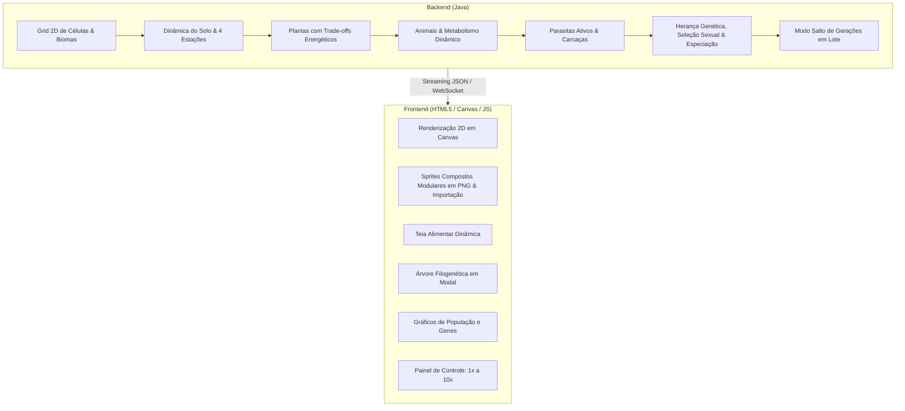

# 🧬 Simulador de Ecossistema e Evolução Natural

> Uma simulação interativa de vida artificial onde criaturas, vegetais e parasitas evoluem sob rigorosos custos energéticos, seleção natural, seleção sexual e adaptação climática em um ecossistema com estações do ano e solos dinâmicos.

---

## 📌 Documentos do Projeto

O projeto possui duas documentações complementares salvas neste repositório:

1. **[Especificação Técnica Completa](DOCUMENTACAO-PROJETO-SIMULACAO-EVOLUCAO.md)**: Documento técnico e formal com todos os modelos matemáticos, fórmulas metabólicas, tabela de biomas e regras detalhadas para entrega acadêmica.
2. **[Documento Vivo de Brainstorm](projeto-simulacao-evolucao.md)**: Histórico de todas as 26 decisões aprovadas e 18 alternativas descartadas durante o processo de design.

---

## 🏗️ Arquitetura do Sistema

O projeto é dividido em uma arquitetura **Cliente-Servidor (Java + Web Canvas)**:

- **Backend (Java):** Responsável por toda a matemática pesada, geração de mapas, ciclo das 4 estações, simulação física e avanço de gerações em lote.
- **Frontend (Web/Canvas):** Interface visual fluida no navegador, com controles de tempo, sprites compostos em camadas (com suporte a importação de imagens customizadas) e painéis científicos modais.
